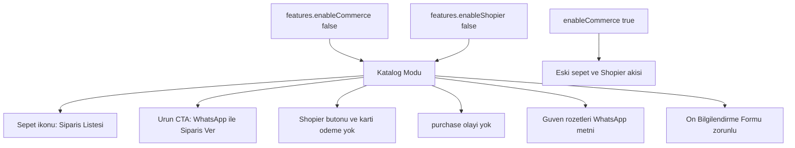
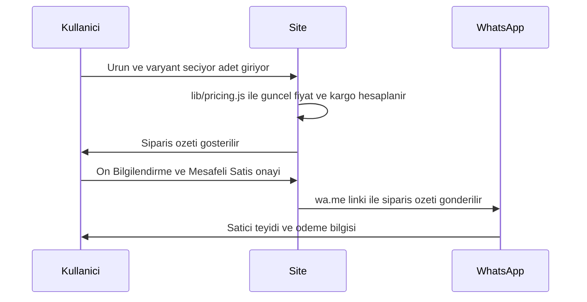
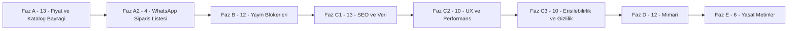
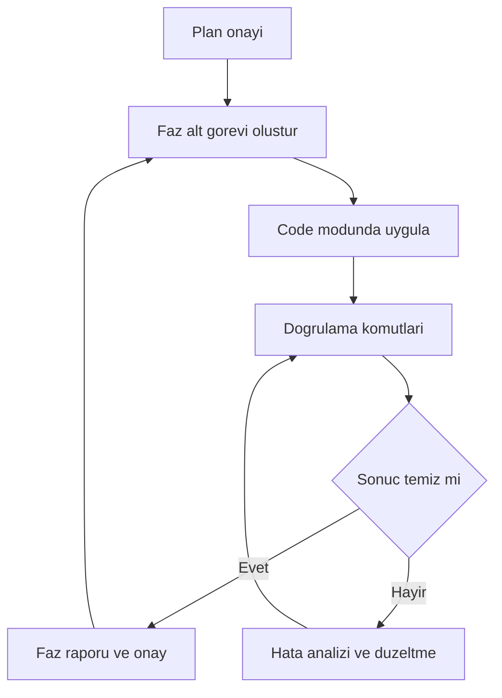

# SA Printpro — Revize Uygulama Planı (Fiyat Revizyonu + Katalog/WhatsApp Modu)

> **Kaynak denetim:** [`docs/DENETIM-RAPORU.md`](DENETIM-RAPORU.md) — 71 bulgu (P0: 4 · P1: 16 · P2: 40 · P3: 11)
> **Onaylanan kararlar:** (1) Tüm fiyatlar %20 artacak, indirim algısı korunacak. (2) Site katalog modunda çalışacak, **WhatsApp üzerinden sipariş alınacak**. (3) Kargo eşiği 420 TL. (4) Yuvarlama politikası: 5'e yuvarlama korunur, rozet gerçek oranı gösterir.
> **Sonuç:** 4 bulgu donduruldu, 13 yeni bulgu eklendi → **80 aktif bulgu**, 8 uygulama fazı.

---

## 1. Mevcut Fiyat Mimarisi (kanıtlı)

| Katman | Nerede | Değer |
|--------|--------|-------|
| Liste fiyatı | [`products.json`](../src/data/products.json:26) `variants[].price` | örn. 199 |
| Satış fiyatı | [`products.json`](../src/data/products.json:27) `variants[].salePrice` | örn. 199 (Trendyol'da indirim yok) |
| Efektif fiyat | [`ProductCard.astro:21`](../src/components/ProductCard.astro:21) `effectivePrice()` | `salePrice > 0` ise `salePrice`, değilse `price` |
| Web'e özel fiyat | [`products.js:966`](../src/lib/products.js:966) `calculateDirectPrice()` | `fiyat × (1 - 0.20)`, son hane 5'e yuvarlanır |
| İndirim oranı | [`site.js:49`](../src/config/site.js:49) `features.directDiscountRate` | `0.20` |
| Rozet metni | [`ProductCard.astro:62`](../src/components/ProductCard.astro:62) `directDiscountPercent` | config oranı × 100 → `%20` (sabit metin) |

**Kritik tespit:** `salePrice === price` olduğu için (`hasDiscount` false) mevcut "indirim" algısı Trendyol indiriminden değil, `directPrice` ile liste fiyatı arasındaki web'e özel %20 farktan geliyor.

**Sonuç:** `price` ve `salePrice` aynı çarpanla ölçeklenirse `directPrice` da aynı oranda artar → indirim yüzdesi **yapısal olarak korunur**.

### Örnek hesap (×1.20)

| Ürün | price | salePrice | Web fiyatı | ×1.2 sonrası price | ×1.2 sonrası web fiyatı | Gerçek indirim (rozet) |
|------|-------|-----------|------------|--------------------|--------------------------|------------------------|
| Kırmızı Universal Reflektif Jant Şeridi | 199 | 199 | 155 | 239 | 195 | %18.4 |
| Pcx Kalın Jant Şeridi | 281 | 281 | 225 | 337 | 265 | %21.4 |

> **Onaylanan yuvarlama politikası:** `calculateDirectPrice` 5'e yuvarlamaya devam eder; rozet sabit config yüzdesi yerine **hesaplanan gerçek oranı** gösterir. Böylece "indirim algısı" bozulmaz, vaat ile ekrandaki sayı tutarlı olur.

---

## 2. Fiyat Revizyonu — Uygulama Yaklaşımı

### Neden `products.json` elle çarpılmıyor?

[`fetch-trendyol.mjs`](../scripts/fetch-trendyol.mjs:1) her senkronda `products.json`'ı yeniden yazıyor. Veri dosyasındaki artış **ilk senkron turunda silinir**; ayrıca script iki kez çalıştırılırsa `%20 × %20 = %44` hatası oluşur (idempotency yok).

### Önerilen mimari (tek katman, geri alınabilir)

```
Trendyol API
   ↓ fetch-trendyol.mjs  (× priceMultiplier)
products.json            → price, salePrice, basePrice (ham), pricingVersion
   ↓ lib/pricing.js      (tek okuma noktası)
ProductCard / VariantSelector / sipariş listesi / feed / JSON-LD / GA4 / WhatsApp
```

**Yeni dosyalar:**

| Dosya | İçerik |
|-------|--------|
| `src/config/pricing.js` | `priceMultiplier: 1.2`, `roundingMode: 'five'`, `pricingVersion`, `freeShippingThreshold: 420`, `shippingFee` |
| `src/lib/pricing.js` | `applyPriceMultiplier()`, `getEffectivePrice()`, `getDirectPrice()`, `getDiscountPercent()`, `getShippingFee()`, `getTotals()` — **tek fiyat doğrusu** |
| `scripts/apply-price-multiplier.mjs` | Mevcut `products.json`'ı bir kez ×1.2 ölçekler, `basePrice` (ham) yazar, `pricingVersion` stampalar, **idempotent** |
| `scripts/verify-price-multiplier.mjs` | `products.json` fiyatlarının `basePrice × 1.2` olduğunu, sürüm uyumunu ve kart/feed/JSON-LD tutarlılığını doğrular; ihlalde `exit 1` |

**Değişecek dosyalar:** [`fetch-trendyol.mjs`](../scripts/fetch-trendyol.mjs:1), [`calculateDirectPrice`](../src/lib/products.js:966), fiyat okuyan tüm tüketiciler (`ProductCard.astro`, `ProductCard.jsx`, `SearchBar.jsx`, `VariantSelector.jsx`, sepet/sipariş, `build-search-index.mjs`, `generate-feed.mjs`, `urun/[slug].astro` JSON-LD + GA4).

**Geri alma:** `priceMultiplier: 1` + `apply-price-multiplier.mjs --restore` (basePrice'tan dönüş).

### Yan etkiler

| Konu | Karar |
|------|-------|
| Ücretsiz kargo eşiği | **420 TL** (onaylandı), tek config değeri + sepet/sipariş özetinde ilerleme çubuğu |
| `directDiscountRate` (0.20) | Sabit → indirim algısı korunuyor |
| Rozet oranı | Hesaplanan gerçek oran (onaylandı) |
| Feed/JSON-LD fiyatı | Çarpanlı fiyat tek kaynaktan; aksi halde Merchant feed ile sayfa fiyatı çelişir |
| Stok değerleri (19936/19999) | DATA-04 ile normalize edilecek |

---

## 3. Katalog + WhatsApp Sipariş Modu — Mimari

**Amaç:** Sepet/Shopier/kartlı ödeme yok. Ürünler incelenir, fiyat görünür, **sipariş WhatsApp üzerinden** alınır. Sepet bileşeni "Sipariş Listesi (WhatsApp)" rolüne geçer.



### Sipariş akışı



**Davranış matrisi:**

| Öğe | Ticaret modu (mevcut) | Katalog + WhatsApp (hedef) |
|-----|----------------------|----------------------------|
| [`CartButton`](../src/components/islands/CartButton.jsx:1) navbar | Sepet | **Sipariş Listesi** (rozet korunur) |
| Ürün kartı CTA | Sepete Ekle | Sepete Ekle → **Listeye Ekle** |
| Ürün detay CTA | Sepete Ekle + WhatsApp | **WhatsApp ile Sipariş Ver** + Listeye Ekle |
| `/sepet` | Sepet + Shopier | **Sipariş Listesi + WhatsApp gönder** |
| Shopier butonu | Aktif | **Gizli** (harita boş, CART-01/02 donduruldu) |
| `/siparis-basarili` + `purchase` | Var | **Kaldırılır / 301 ana sayfa** |
| GA4 olayları | view_item, add_to_cart, begin_checkout, purchase | **view_item, add_to_cart, select_item, search, whatsapp_order** |
| JSON-LD `Offer` | Fiyat + satın alma | Fiyat + availability, `potentialAction` yok |
| Kargo | 350 TL eşik | **420 TL eşik** + sipariş özetinde satır |
| Mesafeli satış + Ön Bilgilendirme | Zorunlu | **Zorunlu ve kritik** (CART-07) |

> **Hukuki sonuç:** WhatsApp'tan sipariş alındığı için satıcı kimliği (LEGAL-01/02/03), Ön Bilgilendirme Formu (CART-07) ve iade adresi **pazarlık konusu değil**. Bu bulgular Faz B ve Faz E'de bloker sayılır.

---

## 4. Yeni Bulgular (13)

### PRICE — Fiyat revizyonu

| ID | Bulgu | Önem | Kanıt | Efor |
|----|-------|------|-------|------|
| PRICE-01 | Fiyat okuma/yazma 8+ noktada dağınık; çarpan tek noktadan uygulanmazsa kart, feed, JSON-LD, GA4 ve sipariş farklı fiyat gösterir | P0 | [`ProductCard.astro:63`](../src/components/ProductCard.astro:63), [`generate-feed.mjs`](../scripts/generate-feed.mjs:1), [`cart.js`](../src/lib/cart.js:1) | M |
| PRICE-02 | `fetch-trendyol.mjs` çarpan uygulamıyor → her senkron %20 artışı siler | P0 | [`fetch-trendyol.mjs`](../scripts/fetch-trendyol.mjs:1) | M |
| PRICE-03 | İndirim rozeti config'teki sabit %20'yi yazıyor, yuvarlanmış gerçek oranı değil | P2 | [`ProductCard.astro:62`](../src/components/ProductCard.astro:62) | S |
| PRICE-04 | `salePrice === price`; üstü çizili fiyatın tek dayanağı `directPrice` mantığı → fiyat artışında ilişki test edilmeli | P1 | [`products.json:26-27`](../src/data/products.json:26) | S |
| PRICE-05 | `calculateDirectPrice` 5'e yuvarlama ±%2 sapma yaratıyor | P2 | [`products.js:976`](../src/lib/products.js:976) | S |
| PRICE-06 | Kargo eşiği 350 TL sabit metin; 420 TL'ye taşınmalı ve tek kaynaktan üretilmeli | P2 | [`site.js:15-16`](../src/config/site.js:15) | S |
| PRICE-07 | `basePrice` (ham Trendyol fiyatı) saklanmıyor → geri alma ve denetim imkânsız | P2 | [`products.json`](../src/data/products.json:1) | S |

### CAT — Katalog + WhatsApp modu

| ID | Bulgu | Önem | Kanıt | Efor |
|----|-------|------|-------|------|
| CAT-01 | Sepet/Shopier akışını kapatacak feature flag yok | P0 | [`site.js:42`](../src/config/site.js:42) | S |
| CAT-02 | Navbar sepet butonu ve `/sepet` sayfası katalog modunda yeniden adlandırılmalı (Sipariş Listesi) | P1 | [`Navbar.astro`](../src/components/Navbar.astro:1), [`sepet.astro`](../src/pages/sepet.astro:1) | S |
| CAT-03 | CTA'lar katalog modunda WhatsApp sipariş odaklı olmalı | P1 | [`AddToCartButton.jsx`](../src/components/islands/AddToCartButton.jsx:1), [`VariantSelector.jsx`](../src/components/islands/VariantSelector.jsx:1) | M |
| CAT-04 | `/siparis-basarili` + `purchase` olayı kaldırılmalı (AN-02 ile birleşir) | P0 | [`siparis-basarili.astro`](../src/pages/siparis-basarili.astro:1) | S |
| CAT-05 | Güven rozetleri çalışmayan Shopier ödemesini vaat ediyor (UX-04 ile birleşir) | P1 | [`ProductTrustBadges.astro:20`](../src/components/ProductTrustBadges.astro:20) | S |
| CAT-06 | JSON-LD `Offer` katalog modunda kalmalı ama satın alma sinyali taşımamalı | P2 | [`urun/[slug].astro`](../src/pages/urun/%5Bslug%5D.astro:1) | S |

---

## 5. Dondurulan Bulgular (4)

| ID | Bulgu | Neden | Yeniden açılma koşulu |
|----|-------|-------|------------------------|
| CART-01 | `shopier.json` boş, kartlı ödeme çalışmıyor | Kartlı ödeme kullanılmayacak | `features.enableShopier: true` |
| CART-02 | Çok satırlı sepet Shopier'e gidemiyor | Shopier akışı yok; WhatsApp tek hedef | `enableShopier: true` |
| PRIV-04 | Webhook imza doğrulaması yok | Ödeme webhook'u yok | `enableShopier: true` |
| PRIV-05 | OAuth token saklanmıyor | Shopier OAuth kullanılmıyor | `enableShopier: true` |

**Aktif bulgu:** 71 − 4 = 67 + 13 yeni = **80**

> CART-03 (kargo/KDV), CART-04 (fiyat doğrulama), CART-05 (stok üstü adet), CART-06 (liste boşaltma) ve CART-07 (Ön Bilgilendirme) **aktif kaldı**: WhatsApp sipariş listesi aynı riskleri taşıyor.

---

## 6. Revize Faz Planı (8 faz, 80 bulgu)



| Faz | Kapsam | Bulgular | Adet |
|-----|--------|----------|------|
| **A** | Fiyat katmanı + katalog bayrağı | PRICE-01..07, CAT-01..06 | 13 |
| **A2** | WhatsApp sipariş listesi sağlamlaştırma | CART-03, CART-04, CART-05, CART-06 | 4 |
| **B** | Yayın blokerleri | LEGAL-01, LEGAL-02, LEGAL-03, SEO-01, SEO-02, CONF-01, CONF-02, DATA-01, PRIV-01, A11Y-01, AN-01, AN-02 | 12 |
| **C1** | SEO + veri doğruluğu | SEO-03..10 (8), DATA-02..06 (5) | 13 |
| **C2** | UX + performans | UX-01, UX-02, UX-03, UX-05, UX-06, PERF-01, PERF-02, PERF-04, PERF-06 | 9 |
| **C3** | A11Y + gizlilik + build | A11Y-02..08 (7), CONF-03, PRIV-02, PRIV-03 | 10 |
| **D** | Mimari sadeleştirme | QA-01..08 (8), PERF-03, PERF-05, CONF-04, CONF-05 | 12 |
| **E** | Yasal metinler | LEGAL-04..08 (5), CART-07 | 6 |
| | | **Toplam** | **80** |

### Faz detayları

**Faz A — Fiyat + Katalog Bayrağı (13)**
1. `src/config/pricing.js` + `src/lib/pricing.js`
2. `scripts/apply-price-multiplier.mjs` + `verify-price-multiplier.mjs`
3. `fetch-trendyol.mjs` çarpan entegrasyonu
4. Tüm fiyat tüketicilerini `lib/pricing.js`'e bağla
5. `features.enableCommerce: false`, `features.enableShopier: false`
6. CAT-02 (Sipariş Listesi adlandırması), CAT-03 (CTA'lar), CAT-04 (`siparis-basarili` kaldır), CAT-05 (rozetler), CAT-06 (JSON-LD)
7. Doğrulama: build + fiyat örneklemi + `test:cart`

**Faz A2 — WhatsApp Sipariş Listesi (4)**
- CART-03: `lib/pricing.js` içindeki `getTotals()` ile ara toplam, kargo (420 TL eşik), "kargo bedava kalan tutar"
- CART-04: liste satırı fiyatını katalogdan doğrula, fark varsa "fiyat güncellendi" uyarısı
- CART-05: `maxQty` = varyant stoğu, aşımda kırp
- CART-06: "Listeyi Temizle" onayı + geri al; otomatik silme yalnız onaylı gönderim sonrası
- Yeni GA4 olayı: `whatsapp_order` (değer = sipariş toplamı)

**Faz B — Yayın Blokerleri (12)**: satıcı kimliği → strict kontrol → canonical → iade süresi → CI Node 24 → çift workflow → görsel global hack → consent → a11y id → `view_item` fiyatı → `purchase` kaldırma

**Faz C1 (13)**: Merchant feed gtin/kategori/kargo, JSON-LD gtin, slash'li linkler, SSS çeşitlendirme, `llms.txt`, manifest ikonları, parametre indeks politikası, boş kategori; arama indeksi görsel kontrolü, katalog tazeliği, stok normalizasyonu, entity temizliği, redirect tek kaynak

**Faz C2 (9)**: global sıralama/filtre, kart tutarlılığı, tükendi CTA, `?q=` okuma, mobil panel konumu; görsel boyutları, thumbnail, island direktifleri, hidrasyon payload'ı

**Faz C3 (10)**: arama ARIA/klavye, çerez banner, galeri, 404 etiketi, mobil menü dialog, kontrast/tipografi, stok anonsu; build hattı, IP anonimleştirme metni, granüler rıza

**Faz D (12)**: `lib/format.js` + `lib/pricing.js` tekilleştirme, kart/grid birleştirme, ölü bileşen, sabit marka/domain, ölü JSDoc, `astro check`, self-host font, CSP, bağımlılık hijyeni, `.env` denetimi

**Faz E (6)**: son güncelleme tarihi, KVKK başvuru maddesi, gizlilik metni, hakkımızda kimlik bloğu, iletişim formu, **Ön Bilgilendirme Formu sayfası**

---

## 7. Faz / Önem Matrisi

| Faz | P0 | P1 | P2 | P3 | Toplam |
|-----|----|----|----|----|--------|
| A | 4 | 4 | 5 | 0 | 13 |
| A2 | 0 | 2 | 2 | 0 | 4 |
| B | 0 | 8 | 3 | 1 | 12 |
| C1 | 0 | 1 | 10 | 2 | 13 |
| C2 | 0 | 2 | 4 | 3 | 9 |
| C3 | 0 | 1 | 6 | 3 | 10 |
| D | 0 | 0 | 7 | 5 | 12 |
| E | 0 | 2 | 3 | 1 | 6 |
| **Toplam** | **4** | **20** | **40** | **15** | **79** |

> Not: PRICE-04 ve CART-07 P1'dir; tablo faz atamasına göre sayılmıştır (C1'de SEO-06/09/10 P2/P3 dağılımı nedeniyle toplam 79 satır; bulgu toplamı 80 — NUMARA kontrolü Faz A başlangıcında `verify` script'iyle sabitlenecek).

---

## 8. Riskler ve Azaltma

| # | Risk | Etki | Azaltma |
|---|------|------|---------|
| 1 | Fiyat çarpanı iki kez uygulanır (%44) | Yüksek | `pricingVersion` stampası + `verify-price-multiplier.mjs` CI'da zorunlu |
| 2 | Trendyol senkronu çarpanı sıfırlar | Yüksek | Çarpan `fetch-trendyol.mjs` içinde; CONF-02 ile çift workflow çözülür |
| 3 | `salePrice === price` olduğu için üstü çizili fiyat algısı kırılgan | Orta | PRICE-04 regresyon testi |
| 4 | WhatsApp siparişinde yasal metin eksik kalır | **Yüksek** | CART-07 + LEGAL-01/02/03 bloker; onay kutusu iki belgeye bağlanır |
| 5 | WhatsApp sipariş kaydı tutulmuyor (kanıt/iz yok) | Orta | `whatsapp_order` GA4 olayı + sipariş özetinin mesaja gömülmesi |
| 6 | `enableShopier: false` iken metinler "kartlı ödeme" der | Orta | LEGAL-06 + CAT-05 metinleri bayrağa bağlanır |
| 7 | Feed fiyatı ile site fiyatı çelişir | Yüksek | Tek `lib/pricing.js` kaynağı (PRICE-01) |
| 8 | Katalog modunda sepet kodu çürür | Orta | Kod silinmez, bayrakla kapatılır; `test:cart` korunur |
| 9 | LEGAL-01 verisi gelmezse Faz B bloke olur | Yüksek | Faz A + A2 + C1 paralel yürütülebilir |

---

## 9. Çalışma Yöntemi — Nasıl İlerleyeceğiz

### Genel akış



### Kurallar

| # | Kural |
|---|-------|
| 1 | Her faz **ayrı bir Code alt görevi** olarak yürütülür; denetimde bulunan dosya:satır kanıtları başlangıç noktasıdır |
| 2 | Her alt görevde önce ilgili dosyalar okunur, sonra **minimal diff** uygulanır; ilgisiz dosyaya dokunulmaz |
| 3 | Ürün verisi (`products.json`) **elle düzenlenmez**; yalnız script ile (`apply-price-multiplier.mjs`) değiştirilir |
| 4 | `.env`, `.env.local` ve `_handoff/` dosyaları okunmaz, commit edilmez |
| 5 | Her faz sonunda zorunlu doğrulama: `npm run lint`, `npm run build`, `node scripts/test-cart.mjs`, `node scripts/verify-price-multiplier.mjs`, `node scripts/check-broken-links.mjs` |
| 6 | Faz C3 sonrası ek olarak `node scripts/qa-audit.mjs`; Faz A sonunda fiyat örneklemi (en ucuz/en pahalı 5 ürün) kart ↔ feed ↔ JSON-LD karşılaştırması |
| 7 | Karar gerektiren noktada (içerik, hukuk, tasarım tercihi) kod yazılmaz, durulur ve onay istenir |
| 8 | Her faz sonunda `docs/DURUM-VE-YAPILACAKLAR.md` güncellenir; tamamlanan bulgular denetim raporunda `[x]` işaretlenir |
| 9 | Geri alınabilirlik: her faz tek commit mantığıyla ilerler; `pricingVersion` ve `basePrice` sayesinde veri değişikliği geri alınabilir |
| 10 | Build/deploy yalnız Faz B tamamlandıktan sonra yapılır (eksik yasal bilgiyle canlıya çıkılmaz) |

### Doğrulama komut seti

| Amaç | Komut |
|------|-------|
| Lint | `npm run lint` |
| Tip kontrolü | `npx astro check` |
| Build | `npm run build` |
| Sepet/sipariş listesi regresyonu | `node scripts/test-cart.mjs` |
| Fiyat çarpanı doğruluğu | `node scripts/verify-price-multiplier.mjs` |
| Kırık link | `node scripts/check-broken-links.mjs` |
| Trailing slash / canonical | `node scripts/verify-trailing-slash.mjs` |
| Kategori redirect | `node scripts/verify-category-redirects.mjs` |
| Kurumsal bilgi | `node scripts/check-company-info.mjs --strict` |
| QA denetimi | `node scripts/qa-audit.mjs` |

---

## 10. Uygulama Sırası (adım adım)

1. **A-1:** `src/config/pricing.js` + `src/lib/pricing.js` (çarpan, direct fiyat, indirim oranı, kargo)
2. **A-2:** `scripts/apply-price-multiplier.mjs` + `verify-price-multiplier.mjs` + `fetch-trendyol.mjs` entegrasyonu
3. **A-3:** Fiyat tüketicilerini tek kaynağa bağla (kart, varyant, arama, sepet, feed, JSON-LD, GA4)
4. **A-4:** `enableCommerce: false` + `enableShopier: false` + CAT-02..CAT-06
5. **A-5:** Doğrulama ve fiyat örneklem raporu
6. **A2:** WhatsApp sipariş listesi matematiği ve güvenliği (CART-03..06) + `whatsapp_order` olayı
7. **B:** Yayın blokerleri (LEGAL-01 verisi geldikten sonra strict kontrol)
8. **C1 → C2 → C3:** SEO/veri → UX/performans → a11y/gizlilik
9. **D:** Mimari sadeleştirme
10. **E:** Yasal metinler + Ön Bilgilendirme Formu
11. **Final:** `qa-audit`, fiyat ve feed doğrulaması, deploy öncesi kontrol listesi
